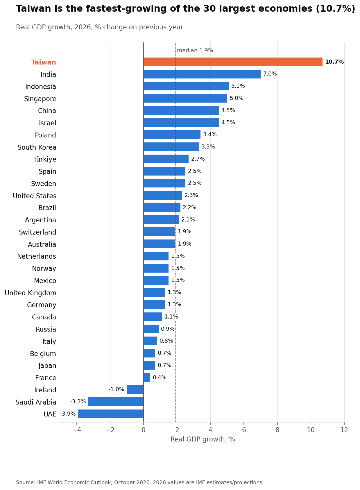
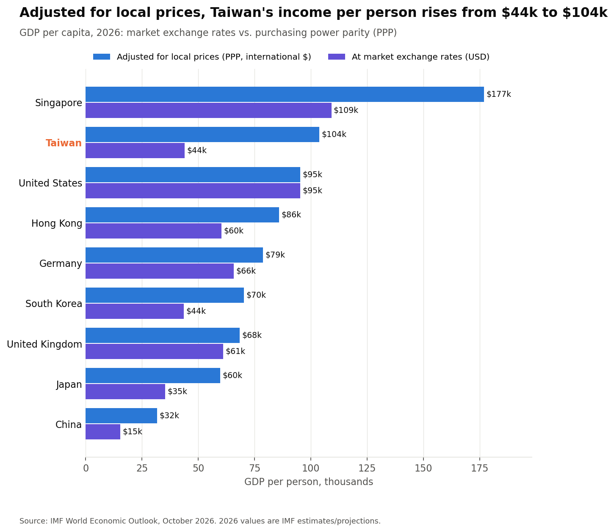
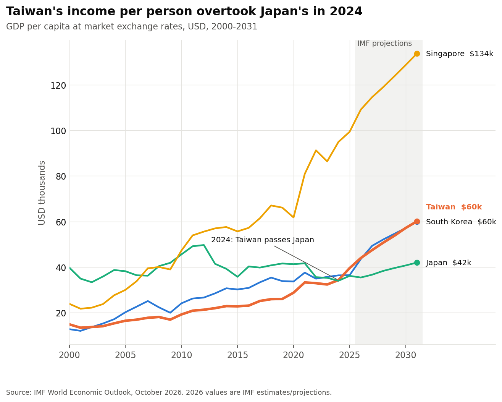
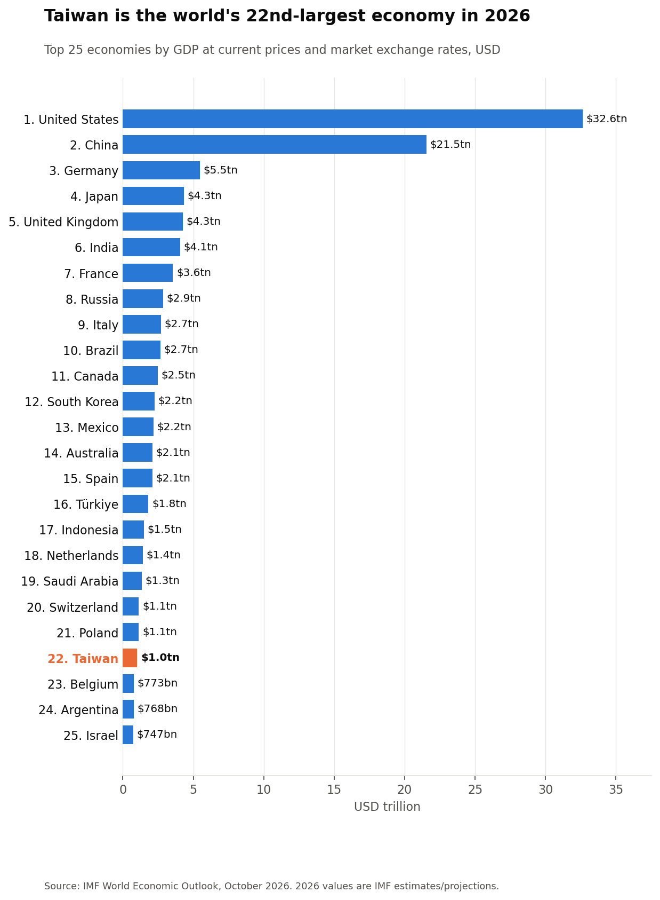
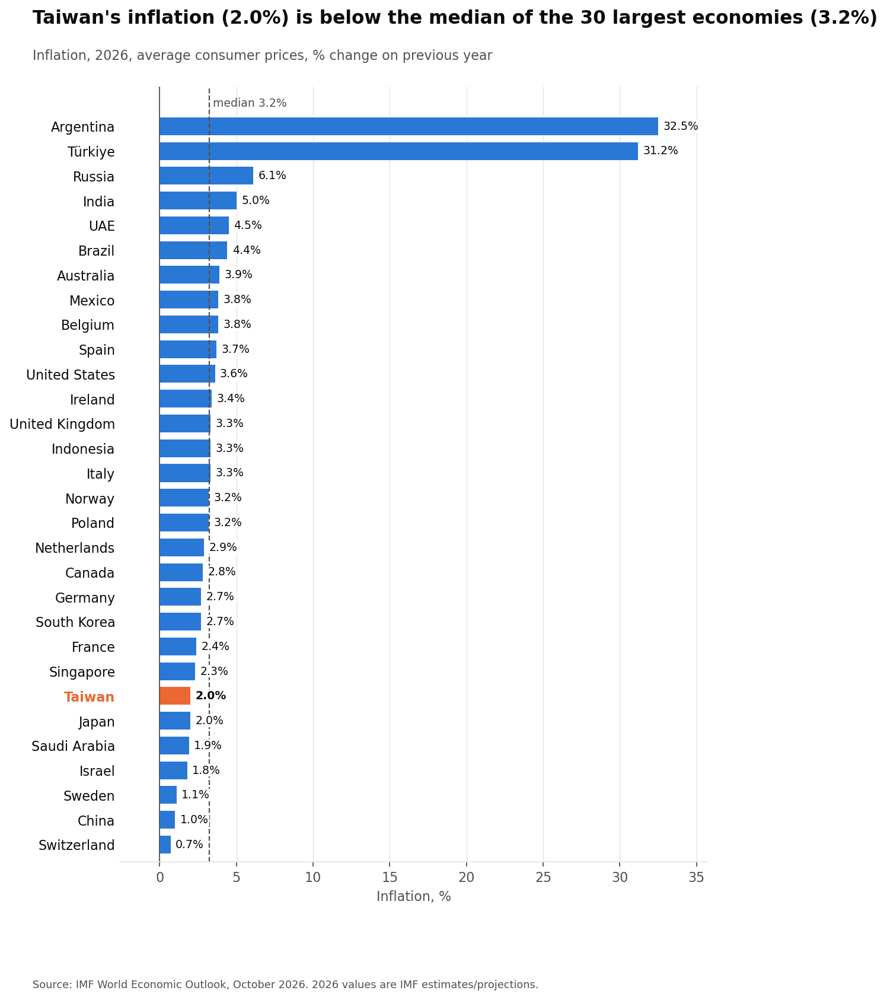

# Global GDP Ranking 2026: Where Does Taiwan Stand?

**I ranked 191 economies on total GDP, GDP per capita and Purchasing Power Parity (PPP), then compared growth and inflation across the 30 largest. The data comes live from the IMF API.**
Many popular GDP datasets leave Taiwan out. The IMF includes it, so this project also looks at where Taiwan ranks and why its position changes so much depending on the measure.

`Python` · `pandas` · `requests (REST API)` · `matplotlib` · `Jupyter`

---

## Key findings

| | Taiwan, 2026 | Rank |
|---|---|---|
| Total GDP | **USD 1.02 trillion** | **22nd** of 191 |
| GDP per capita (market exchange rates) | **USD 43,951** | 31st |
| GDP per capita (PPP, adjusted for local prices) | **USD 103,743** | **9th** |
| Real GDP growth | **10.7%** | **1st** of the 30 largest economies |
| Inflation | 2.0% | below the top-30 median of 3.2% |

1. **Taiwan is the fastest-growing large economy in 2026.** Its 10.7% growth is the highest among the 30 largest economies. India is next at 7.0%, and the median is 1.9%. The IMF raised its forecast from 5.2% in April and links the jump to investment in AI hardware, which Taiwan exports.
2. **Taiwan crossed the USD 1 trillion mark and ranks 22nd by size,** between Poland and Belgium. The US (USD 32.6tn) and China (USD 21.5tn) are far ahead of everyone else. The top 10 economies produce about **two-thirds (65.8%)** of world GDP.
3. **Taiwan's income per person overtook Japan's in 2024.** It is now level with South Korea at about USD 44k, while Japan is at USD 35k.
4. **The same income buys much more in Taiwan.** Taiwan's price level is about **42% of the US level**, the lowest of all the peers compared here. So Taiwan moves from 31st to 9th when measured at purchasing power parity, ahead of the United States.
5. **Taiwan has the growth without the inflation.** Inflation is 2.0%, below the median. Argentina (32.5%) and Türkiye (31.2%) are the outliers among the 30 largest economies.







<details>
<summary>More charts: GDP ranking and inflation</summary>





</details>

<!-- MY ANALYSIS (Jane): add 2–4 sentences in your own words here, e.g.
### What I take from this
- What surprised me most ...
- What this means for a bank / investor / Taiwan's economy ...
-->

---

## Business questions

1. Which economies are the largest in 2026 by **total GDP**, **GDP per capita** and **GDP per capita (PPP)**?
2. Where does **Taiwan** rank on each measure, and why do the rankings differ?
3. Among the 30 largest economies, how do **real growth** and **inflation** compare?

## Data

**Source:** [IMF World Economic Outlook, October 2026](https://www.imf.org/external/datamapper), accessed through the [IMF DataMapper API](https://www.imf.org/external/datamapper/api/help).

| Indicator | IMF code | Unit |
|---|---|---|
| GDP, current prices | `NGDPD` | billions of USD |
| GDP per capita, current prices | `NGDPDPC` | USD |
| GDP per capita, PPP | `PPPPC` | international dollars |
| Inflation, average consumer prices | `PCPIPCH` | annual % change |
| Real GDP growth | `NGDP_RPCH` | annual % change |
| Population | `LP` | millions |

## Method

1. **Extract:** I wrote a reusable function, `get_indicator(code)`, that calls the IMF REST API and parses the nested JSON (`indicator → country → {year: value}`) into a pandas table with one row per country and one column per year.
2. **Clean:** The raw response has 229 entries, but 32 of them are **regional aggregates** (e.g. *World*, *Euro area*). If they stay in, they take over the top of the rankings. I removed them by matching against the IMF's own country list, which leaves 197 economies (191 with a 2026 GDP figure).
3. **Combine:** I merged six indicators into one table for 2026. I also added a derived **price level ratio** (GDP per capita at market rates ÷ GDP per capita at PPP), which shows how expensive a country is relative to the US.
4. **Analyse and visualise:** I built the rankings, Taiwan's position, a peer comparison (Japan, Korea, Singapore, Hong Kong, China, US, UK, Germany) and five charts. Every number quoted in the chart titles and in this README is calculated in the notebook, not typed in by hand.

## Caveats

- **2026 figures are IMF estimates and projections** from October 2026 and will be revised.
- **Exchange rates move the USD rankings.** A weaker currency lowers nominal GDP even if real output does not change.
- **PPP is an estimate.** The World Bank does not publish a PPP figure for Taiwan, so the IMF's PPP for Taiwan is its own estimate, and small changes in assumptions shift it noticeably.
- **Small economies distort per-capita rankings.** Liechtenstein and Luxembourg count cross-border commuters in output but not in population. Ireland books large multinational profits, and its own adjusted measure (GNI*) is much lower. All three rank higher than local living standards suggest.
- **Naming:** The IMF labels Taiwan "Taiwan Province of China". Charts use "Taiwan" for readability; the code `TWN` is unchanged.

## Repository

```
├── global_gdp_2026.ipynb          # full analysis: extract → clean → analyse → charts
├── data/
│   ├── imf_weo_oct2026_raw.csv    # all years, all indicators (long format)
│   ├── gdp_2026_clean.csv         # one row per economy, 2026
│   ├── top30_rankings_2026.csv    # top 30 on each GDP measure
│   └── key_numbers.json           # every figure quoted above
├── images/                        # charts used in this README
└── requirements.txt
```

**Run it yourself:** `pip install -r requirements.txt`, then open the notebook and run all cells. It pulls the latest data straight from the IMF.

---

**Pin-Hsuan (Jane) Lee**, University of Warwick
